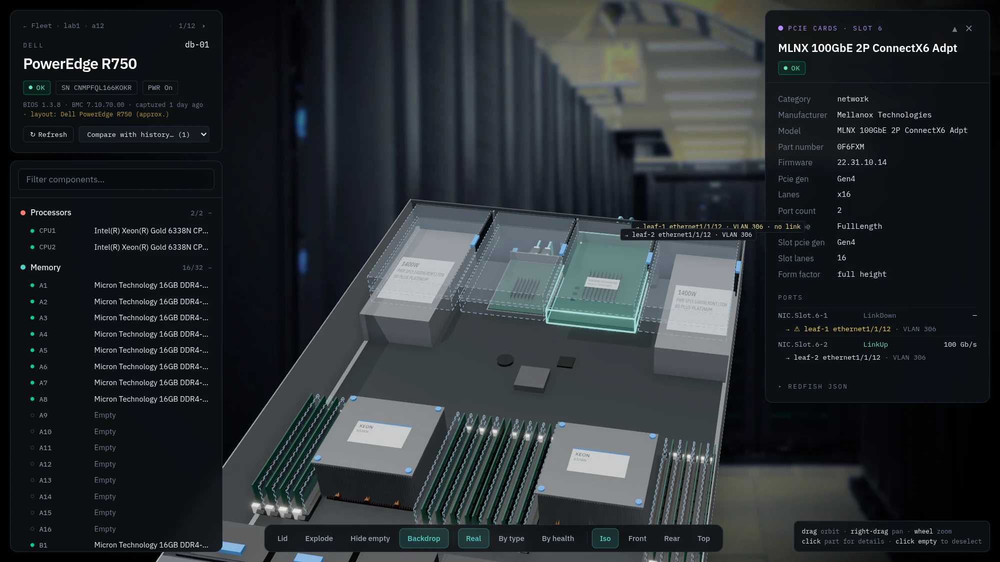
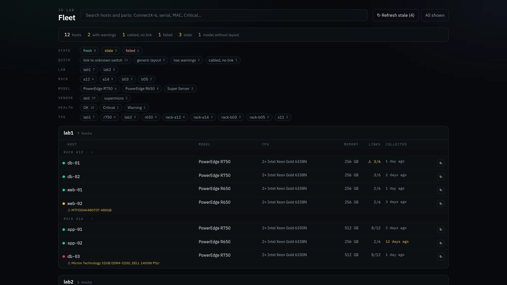
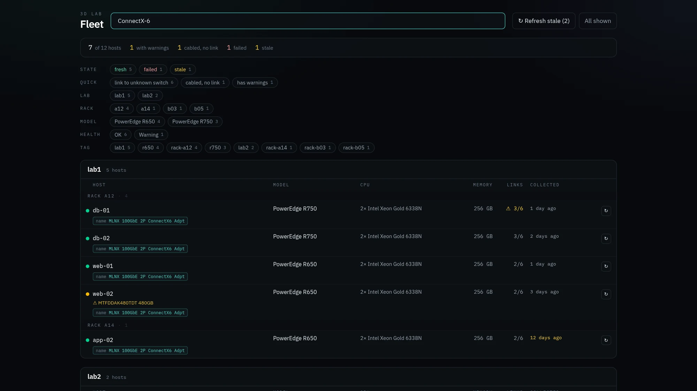
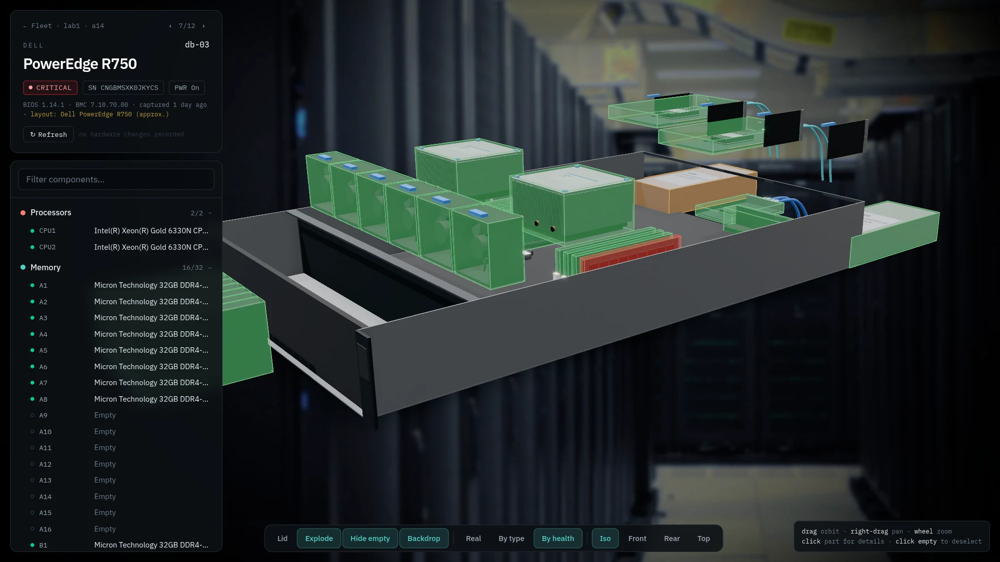
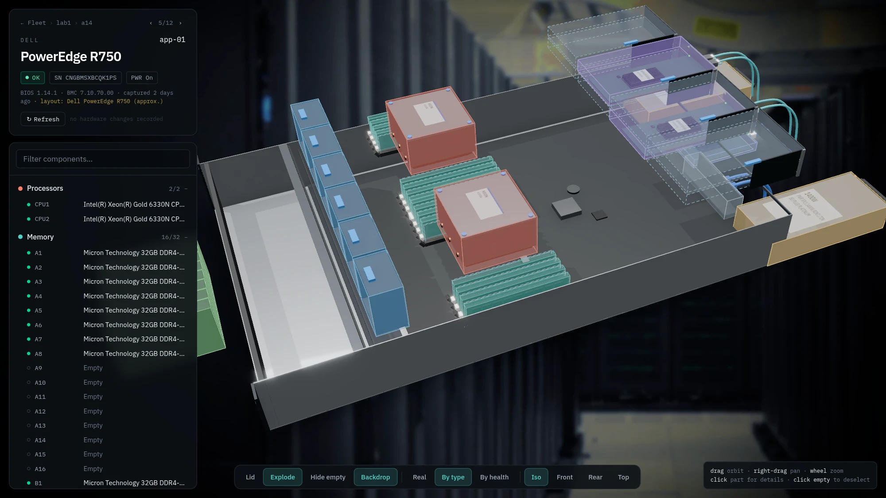
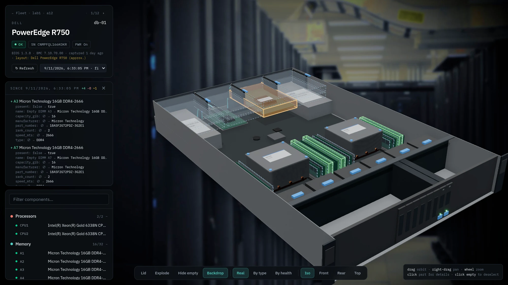
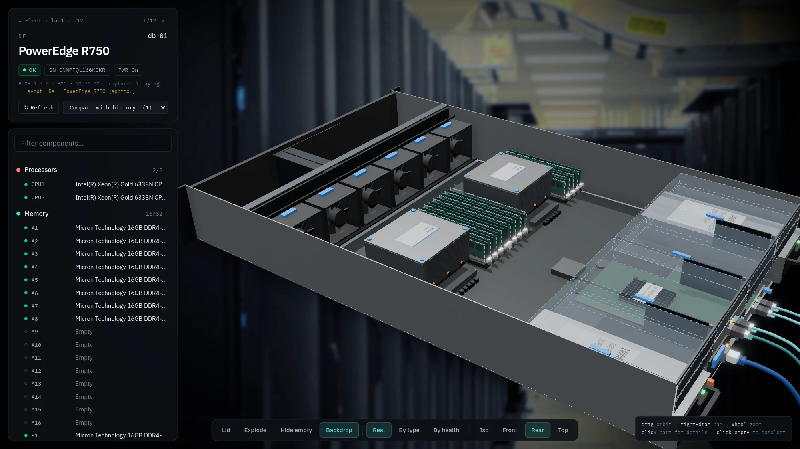
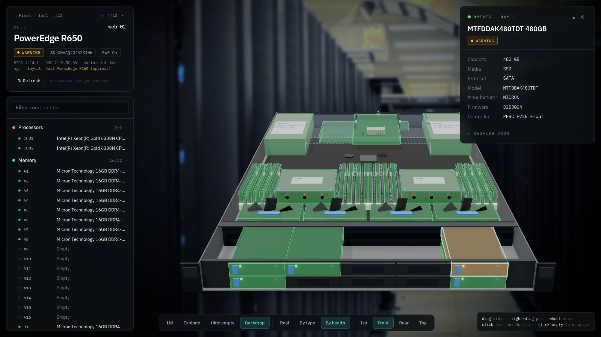
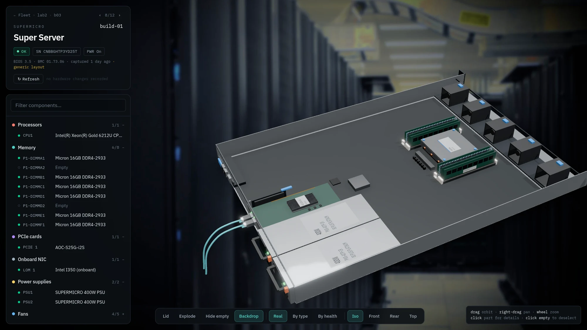

# 3D Lab

**See inside every server in your lab without opening a single chassis.**

https://github.com/user-attachments/assets/68e3357e-ec96-4cfa-870a-fbcadc86a3af

▶ [Full walkthrough on YouTube](https://www.youtube.com/watch?v=fKv7jNFZXJA)

3D Lab reads each server's hardware from its BMC over Redfish and draws it in 3D: CPUs, DIMMs, PCIe/OCP/LOM
NICs, PSUs, fans, drives and empty slots, all colour-coded by health. Click a part for its model, firmware,
serial and link state. It keeps a history of hardware changes and can label every NIC port with the switch
port it is cabled to.

You give it BMC addresses and read-only credentials. It sends only GET requests, so it can never change a
server.

- **Fleet page:** every server, grouped by lab and rack, with health, model and age.
  - **Filters:** health, model, vendor, tag, stale, errors, "cabled but no link".
  - **Search across the fleet:** serial, MAC, part number, `ConnectX-6`, `Critical`, `ethernet1/1/12`.
- **Host view:** an interactive 3D model of the chassis.
  - Click any part for its data.
  - Step through hosts with ← / →.
  - Refresh a host from its BMC.
  - Diff against an earlier snapshot to see what hardware changed, highlighted in 3D.
- **Deep links:** `#/host/db-01/pcie:6` opens slot 6 of `db-01`. Paste it in a ticket or a chat.
- **Collection on demand:** hardware rarely changes, so nothing polls in the background. Refresh a host, a
  lab or everything stale from the UI, the API or the CLI (cron).
- **Any Redfish server:** Dell iDRAC, HPE iLO and Supermicro are tested.
  - **Dell PowerEdge R640, R650, R660, R740, R750, R760 and R7625** have chassis layouts, so their parts
    appear in their real positions.
  - **Everything else** shows every part the BMC reports in a generic arrangement.

## Screenshots

<table>
  <tr>
    <td colspan="2"><a href="docs/screenshots/hero.webp"></a><br>
      <b>Part details and wiring.</b> The selected 100GbE NIC shows its firmware, ports and link state, and the
      switch port and VLAN each port is cabled to. The cabled port without link is flagged.</td>
  </tr>
  <tr>
    <td width="50%"><a href="docs/screenshots/fleet.webp"></a><br>
      <b>Fleet page.</b> Hosts grouped by lab and rack, with health, links and age. The chips filter by state,
      lab, rack, model, vendor, health and tag.</td>
    <td width="50%"><a href="docs/screenshots/search.webp"></a><br>
      <b>Search across the fleet.</b> <code>ConnectX-6</code> finds every host with that card, and shows the matching part.</td>
  </tr>
  <tr>
    <td><a href="docs/screenshots/health.webp"></a><br>
      <b>By health, exploded.</b> A failed DIMM (red) and a degraded PSU (amber) stand out at a glance.</td>
    <td><a href="docs/screenshots/exploded.webp"></a><br>
      <b>By type, exploded.</b> CPUs, memory, drives, NICs and PSUs lifted out of the chassis.</td>
  </tr>
  <tr>
    <td><a href="docs/screenshots/diff.webp"></a><br>
      <b>Hardware history.</b> Compared with a month ago: four DIMMs added (green) and a NIC firmware update
      (orange).</td>
    <td><a href="docs/screenshots/rear.webp"></a><br>
      <b>Rear view.</b> Fans, risers and the cabled NIC ports.</td>
  </tr>
  <tr>
    <td><a href="docs/screenshots/front.webp"></a><br>
      <b>Front view.</b> The drive bays of an R650; bay 1 reports a warning.</td>
    <td><a href="docs/screenshots/generic.webp"></a><br>
      <b>Generic layout.</b> A Supermicro server without a dedicated layout still shows every part it
      reports.</td>
  </tr>
</table>

## Try it in a minute (no BMCs needed)

The repository ships two real servers (an R750 and an R650) and two samples. Their serials, service tags, MACs
and IPs are invented. The UI can show them without the service:

```bash
git clone https://github.com/sshnaidm/3d-lab.git
cd 3d-lab/web
npm ci
VIEWER_PROXY=0 npm run dev        # open http://localhost:5173
```

## Run it against your servers

### Container

```bash
mkdir -p config
cp examples/redfish_servers.yaml examples/redfish_secrets.yaml config/   # then edit them
cp examples/config.yaml config/                                         # optional
echo "VIEWER_API_TOKEN=$(openssl rand -hex 24)" > .env

podman compose up -d        # or: docker compose up -d
```

Open http://localhost:8080 and click **Refresh stale**. It asks for the token, then collects the fleet.

Without compose:

```bash
podman build -t 3d-lab .     # or: docker build -f Containerfile -t 3d-lab .
podman run -d -p 8080:8080 -e VIEWER_API_TOKEN=... \
  -v ./config:/config:ro,Z -v lab3d-data:/data:Z 3d-lab
```

The container uses two volumes:

| Volume | Contents |
|---|---|
| `/config` (read-only) | `redfish_servers.yaml`, `redfish_secrets.yaml`, an optional `config.yaml` and optional wiring files |
| `/data` | The topology store: the index, the latest topology per host, history, remembered ad-hoc hosts |

The image sets the data directory, bind address and port. To use another port, change `-p`, not
`config.yaml`.

### Locally

```bash
python3 -m venv .venv && . .venv/bin/activate
pip install .                                   # Python 3.10+
(cd web && npm ci && npm run build)             # the UI, served by the service from web/dist
cp examples/*.yaml .                            # then edit redfish_servers.yaml and redfish_secrets.yaml
3d-lab                                          # http://127.0.0.1:8080
3d-lab collect --all                            # or collect from the command line (cron-friendly)
```

## Configuration

### Servers

**`redfish_servers.yaml`** lists the servers:

```yaml
servers:
  db-01:
    bmc_ip: 192.0.2.11
    vendor: dell                    # optional, detected from the BMC
    tags: [lab1, rack-a12, r750]    # tags can name the lab and rack
  gpu-01:
    bmc_ip: 192.0.2.31
    lab: lab1                       # explicit lab/rack keys win over tags
    rack: a14
```

**`redfish_secrets.yaml`** holds the credentials. Keep it at mode 0600 and never commit it. A read-only BMC
account is enough.

```yaml
db-01:
  username: readonly
  password: change-me
```

Both files use the same format as [baremetal-mcp](https://github.com/sshnaidm/baremetal-mcp), so existing
files work unchanged.

### Settings

`config.yaml` is optional. [examples/config.yaml](examples/config.yaml) lists every key with comments. The
most useful ones:

| Key | Default | Meaning |
|---|---|---|
| `data_dir` | `data/` | Where the topology store lives |
| `max_age` | `7d` | Data older than this is "stale" (`collect --max-age` and "Refresh stale" use it) |
| `max_concurrent_bmcs`, `max_requests_per_bmc` | `8`, `4` | Collection limits; iDRACs slow down under many parallel sessions |
| `lab_tags`, `lab_tag_pattern`, `rack_tag_pattern` | | How tags map to labs and racks |
| `allowed_bmc_cidrs` | `[]` | Enables **Add server by IP** for BMCs inside these networks |
| `wiring_files` | `[]` | CSV/YAML switch wiring (see below) |
| `open_reads` | `true` | `false` requires the token for reads too |

Every key can be overridden with a `VIEWER_<KEY>` environment variable, for example `VIEWER_DATA_DIR`. The
API token is read only from `VIEWER_API_TOKEN`. The settings file can also be passed with `--config` or
`LAB3D_CONFIG`. A baremetal-mcp `global_config.yaml` works as well: its `viewer:` section is read.

### Adding a server by IP

Use the **Add server** dialog in the UI, or `POST /api/servers` with `name`, `bmc_ip`, `username` and
`password`. This only works for addresses inside `allowed_bmc_cidrs`. Credentials stay in memory unless
**remember** is ticked. Remembered ones are written to `data/adhoc/secrets.yaml` with mode 0600.

### Switch wiring (optional)

List CSV or YAML files in `wiring_files`, for example [examples/wiring.csv](examples/wiring.csv):

```csv
host,interface,mac,switch_id,switch_port,switch_link_state,vlan_id,observed_at,correlation_status,notes
db-01,ens1f0np0,b8:3f:d2:00:00:01,leaf-1,ethernet1/1/1,up,306,2026-10-01T10:00:00Z,matched,
```

Each row needs `host`, `switch_id`, `switch_port`, and either `mac`, `nic_fqdd`, or `nic_slot` with
`host_physical_port`. With wiring loaded:
- cables show their switch port and VLAN;
- cabled ports without link are flagged;
- searching for a switch port finds the host on it.

Files are reloaded when they change, and wiring never creates history entries.

## Security

The service holds BMC credentials for the whole fleet, so it is built to be harmless with them:

- **Only GET requests reach BMCs.** The Redfish client has no other method.
- **Writes need a token.** Refresh, add and remove need `Authorization: Bearer $VIEWER_API_TOKEN`.
  - Without a token, writes are accepted only from loopback clients.
  - Set a token whenever the service listens on anything but localhost. The container always does.
- **Reads are open by default.** `open_reads: false` puts them behind the token too.
- **Nothing leaks in responses or logs:** credentials never appear, and BMC addresses are stripped from
  error messages.
- **Ad-hoc BMC targets** must be IP literals inside `allowed_bmc_cidrs`, so the service can't be used to
  probe arbitrary hosts.
- **Where to run it:** wherever the BMCs are reachable, ideally on the management network behind your SSO
  proxy.

## Command line

| Command | Purpose |
|---|---|
| `3d-lab [serve] [--config F] [--bind A] [--port P]` | Web service (UI + API) |
| `3d-lab collect --all \| --lab L \| --rack R \| --tag T \| --host H [--max-age 7d] [--force]` | Fill the store without the service; `--dry-run` lists what would be collected |
| `3d-lab capture <host> -o file.json` | Redacted raw Redfish of one server, for tests and new layouts |
| `3d-lab export <host>... -o dir` / `--replay file.json <id>` | Static topology JSON for the UI's static mode |
| `3d-lab healthcheck` | Exit 0 when the local service is up (container HEALTHCHECK) |

`capture` redacts the following by default:
- serials, UUIDs and MACs;
- IP addresses;
- Dell service tags, express service codes and PPIDs;
- drive WWNs.

## API

| Endpoint | Purpose |
|---|---|
| `GET /api/servers` | Fleet index. Filters: `lab`, `rack`, `model`, `vendor`, `tag`, `health`, `state` |
| `GET /api/servers/{id}` | Latest topology from the store (no BMC call), with wiring applied |
| `GET /api/servers/{id}/raw` | Raw Redfish per component |
| `GET /api/servers/{id}/history`, `…/history/{ts}/diff` | Hardware-change history and diffs |
| `POST /api/servers/{id}/refresh` (`?force=1`) | Re-read one host from its BMC; returns a job |
| `POST /api/refresh` | Bulk refresh with the same filters as `/api/servers`; `stale_only=1` skips fresh hosts |
| `GET /api/jobs/{id}` | Job progress |
| `POST /api/servers`, `DELETE /api/servers/{id}` | Add or remove an ad-hoc server |
| `GET /api/search?q=` | Hosts and parts by serial, MAC, part number, name or switch port |
| `GET /api/coverage` | Models in the fleet and which still use the generic layout |
| `GET /api/health`, `GET /api/wiring` | Service status; configured wiring files |

## Adding a chassis layout

`GET /api/coverage` shows which of your models still use the generic layout. To add one:

1. Capture a server of that model with `3d-lab capture`.
2. Describe where its slots sit (in millimetres, from the vendor's service manual).
3. Run `npm test`. The layout validation fails on any part that is unplaced, overlapping or outside the
   chassis.

[AGENTS.md](AGENTS.md#layouts) walks through it step by step.

## Using it with baremetal-mcp

3D Lab is standalone. It fits next to [baremetal-mcp](https://github.com/sshnaidm/baremetal-mcp), an MCP
server for BMC and switch operations, because both read the same server and secrets files.
[AGENTS.md](AGENTS.md#integration-with-baremetal-mcp) describes the ways to connect them.

## Development

[AGENTS.md](AGENTS.md) covers the architecture, the topology schema and how layouts work. CI
(`.github/workflows/ci.yml`) runs the same linters and tests on every push and pull request, then builds and
smoke-tests the container.

```bash
pip install -e '.[test,lint]' && pytest           # collector, store, API, wiring, topology builder
black --check -l 120 lab3d tests && flake8 lab3d tests
cd web && npm ci && npm run lint && npm run typecheck
npm test && npm run dev                            # layout validation; the dev server proxies /api to :8080
```

## Credits

The 3D background is "Front of server racks at NERSC" by Derrick Coetzee (Wikimedia Commons, CC0).

## License

Apache-2.0
